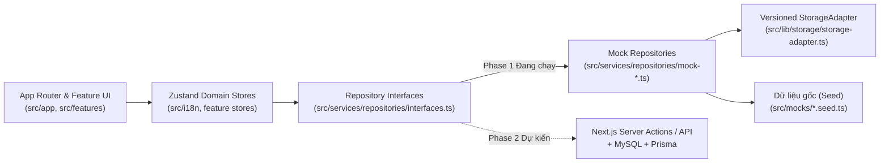

# Kiến trúc Hệ thống (`docs/ARCHITECTURE.md`) — `forma/`

## 1. Nguyên tắc Kiến trúc

`forma/` áp dụng **Feature-First Layered Architecture** trên nền **Next.js 15 App Router**. Dù Phase 1 chạy hoàn toàn trên trình duyệt bằng `localStorage` và dữ liệu seed, mọi luồng dữ liệu đều đi qua **Repository Interfaces** có kiểu dữ liệu chặt chẽ để khi nâng cấp lên Phase 2 (backend + MySQL), phần giao diện UI gần như không phải viết lại.



---

## 2. Trách nhiệm Từng Lớp (Layers)

| Lớp (Layer) | Thư mục | Vai trò chính |
| :--- | :--- | :--- |
| **Routes & Shell** | `src/app/`, `src/components/layout/` | Các trang App Router, layout gốc, font, `DemoModeBar`, `Navbar`, `Footer`. |
| **UI Primitives** | `src/components/ui/` | Các component nền tùy biến từ `shadcn/ui` (`Button`, `Badge`, và sau này là `Dialog`, `Tabs`, `Input`, `Sheet`). |
| **i18n & Tiền tệ** | `src/i18n/`, `src/lib/format/currency.ts` | Từ điển song ngữ `vi`/`en`, tự nhận diện ngôn ngữ trình duyệt sau mount, định dạng & tính toán số nguyên VND/USD. |
| **Domain Contracts** | `src/types/domain.ts` | Kiểu dữ liệu dùng chung toàn hệ thống (`Product`, `DemoUser`, `AuthSession`, `Order`, `Coupon`, `CartItem`). |
| **Repositories** | `src/services/` | Hợp đồng `IProductRepository`, `IAuthRepository`, `IOrderRepository`, `ICouponRepository` và các bản mock tương ứng. |
| **Storage Adapter** | `src/lib/storage/` | Cổng duy nhất giao tiếp `window.localStorage` với envelope `forma:v1:*`, bảo vệ SSR, tự phục hồi JSON hỏng và `resetAllDemoData()`. |
| **Seed Fixtures** | `src/mocks/` | 18 sản phẩm mẫu, 2 tài khoản demo chọn sẵn, 3 mã giảm giá thử nghiệm. |

---

## 3. Cơ chế Tránh Lỗi SSR Hydration khi dùng `localStorage`

Next.js App Router render nháp component trên server trước khi gửi HTML xuống trình duyệt (áp dụng cho cả `'use client'` components). Trên server không có `window.localStorage` hay `navigator.language`, nên nếu đọc chúng ngay trong lúc render đầu tiên sẽ làm HTML server khác với client (lỗi Hydration Mismatch).

`forma/` giải quyết triệt để qua 2 bước:
1. State khởi tạo mặc định của Zustand store luôn cố định giống nhau trên cả Server và Client (`locale: 'vi'`, `currency: 'VND'`).
2. Component `<AppHydration />` đặt trong [layout.tsx](file:///c:/BusinessWeb/Selling_tem/src/app/layout.tsx) chạy `useEffect` (chỉ thực thi sau khi đã mount trên trình duyệt) để đọc `StorageAdapter` / `navigator.language` và cập nhật lại store êm mượt.

---

## 4. Định dạng Lưu trữ & Tự phục hồi Dữ liệu Hỏng

Mọi dữ liệu ghi qua [storage-adapter.ts](file:///c:/BusinessWeb/Selling_tem/src/lib/storage/storage-adapter.ts) đều được bọc trong cấu trúc envelope có phiên bản:

```json
{
  "version": "v1",
  "updatedAt": "2026-11-20T05:00:00.000Z",
  "data": { ... }
}
```

Nếu `JSON.parse` gặp lỗi, `version` lệch với `STORAGE_SCHEMA_VERSION`, hoặc hàm kiểm tra kiểu dữ liệu (validator) trả về `false`, `readStorage()` tự động xóa key hỏng và trả về `defaultValue` để ứng dụng không bao giờ bị sập màn hình trắng.

---

## 5. Mô hình Bảo mật cho Smart Hybrid Preview (Phase 1.3 & Tương lai)

- **Phase 1.3 (Đã triển khai):** Hệ thống Preview (`src/features/preview/registry/preview-registry.tsx`) phân tách làm 3 nhánh rõ ràng qua `previewComponentKey`:
  1. **Controlled React Preview Registry (`kind: 'react-component'`):** Nạp lười (`next/dynamic`) các component demo được viết sẵn và kiểm soát trong source code (`interactive-demos.tsx`, `section-demos.tsx`).
  2. **Sandboxed Static HTML Iframe (`kind: 'static-iframe'`):** Các website template tĩnh độc lập (`public/demo-previews/orbit/index.html`, `public/demo-previews/northbound/index.html`) được nhúng qua `<iframe sandbox="allow-scripts" loading="lazy">`. Việc **cố tình bỏ `allow-same-origin`** ép trình duyệt chạy iframe trong một *opaque origin* tách biệt, nên JS bên trong bản demo có thể tương tác UI bình thường nhưng **bị chặn tuyệt đối** không đọc được `localStorage`, cookie hay DOM của cửa hàng chính.
  3. **Honest Mock Fallback (`previewComponentKey === null`):** Hiển thị màn hình thông báo minh bạch thay vì giả vờ chạy code thật. Hệ thống không tự biên dịch hay chạy file ZIP do người dùng upload.
- **Phase 2+ (Nếu cho phép preview bundle upload từ ngoài):** Bắt buộc phục vụ file từ một **origin/domain tách biệt hoàn toàn** kèm header CSP chặt và `<iframe sandbox="allow-scripts">`.

---

## 6. Lộ trình Nâng cấp lên Phase 2 (Backend & MySQL)

Khi bắt đầu Phase 2:
1. **Database (MySQL + Prisma):** Thiết kế schema MySQL khớp với các entity trong `src/types/domain.ts` (`Product`, `User`, `Order`, `OrderItem`, `Coupon`, `UserEntitlement`).
2. **Thay thế Repository:** Tạo `PrismaProductRepository`, `ServerOrderRepository`... gọi qua Next.js Server Actions / Route Handlers theo đúng các interface đã định nghĩa sẵn trong `src/services/repositories/interfaces.ts`.
3. **Authentication:** Đánh giá và tích hợp auth provider tương thích tốt với MySQL + Prisma (ví dụ Auth.js v5 hoặc Better Auth kèm adapter MySQL).
4. **Private Storage & Kiểm quyền trên Server:** Đưa file `.zip` lên object storage riêng tư (S3 / Cloudflare R2). Chỉ cấp link tải có thời hạn (signed URL) và trả full source code cho Monaco Viewer **sau khi server kiểm tra bảng quyền sở hữu trong MySQL**.
5. **Tính tiền trên Server:** Tuyệt đối không tin giá tiền hoặc mã giảm giá gửi từ trình duyệt; server phải tự truy vấn giá gốc từ MySQL trước khi tạo phiên thanh toán.
