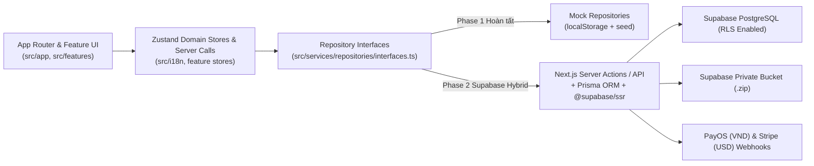

# Kiến trúc Hệ thống (`docs/ARCHITECTURE.md`) — `forma/`

## 1. Nguyên tắc Kiến trúc

`forma/` áp dụng **Feature-First Layered Architecture** trên nền **Next.js 15 App Router**. Ở Phase 1, dữ liệu chạy qua `localStorage` và dữ liệu seed; sang **Phase 2**, `forma/` áp dụng mô hình **Supabase Hybrid (`ADR-008`)** — dùng **Prisma ORM** nối Supabase PostgreSQL + **Supabase Auth** (`@supabase/ssr`) + **Supabase Private Storage**, còn toàn bộ nghiệp vụ Admin/Checkout/Payment (`PayOS` + `Stripe`) chạy tập trung trên Next.js Server thông qua bộ **Repository Interfaces** để dễ dàng tách sang hạ tầng tự chủ về sau.



---

## 2. Trách nhiệm Từng Lớp (Layers)

| Lớp (Layer) | Thư mục | Vai trò chính |
| :--- | :--- | :--- |
| **Routes & Shell** | `src/app/`, `src/components/layout/` | Các trang App Router, layout gốc, font, `Navbar`, `HeaderSwitchers`, `Footer`. |
| **UI Primitives** | `src/components/ui/` | Các component nền tùy biến từ `shadcn/ui` (`Button`, `Badge`, và sau này là `Dialog`, `Tabs`, `Input`, `Sheet`). |
| **i18n & Tiền tệ** | `src/i18n/`, `src/lib/format/currency.ts` | Từ điển song ngữ `vi`/`en`, tự nhận diện ngôn ngữ trình duyệt sau mount, định dạng & tính toán số nguyên VND/USD. |
| **Domain Contracts** | `src/types/domain.ts` | Kiểu dữ liệu dùng chung toàn hệ thống (`Product`, `DemoUser`, `AuthSession`, `Order`, `Coupon`, `CartItem`). |
| **Repositories** | `src/services/` | Hợp đồng `IProductRepository`, `IAuthRepository`, `IOrderRepository`, `ICouponRepository` và các bản mock tương ứng. |
| **Storage Adapter** | `src/lib/storage/` | Cổng duy nhất giao tiếp `window.localStorage` với envelope `forma:v1:*`, bảo vệ SSR, tự phục hồi JSON hỏng và `resetAllDemoData()`. |
| **Seed Fixtures** | `src/mocks/` | 18 sản phẩm mẫu, 2 tài khoản demo chọn sẵn, 3 mã giảm giá thử nghiệm. |

---

## 3. Cơ chế Tránh Lỗi SSR Hydration khi dùng `localStorage`

Next.js App Router render nháp component trên server trước khi gửi HTML xuống trình duyệt (áp dụng cho cả `'use client'` components). Trên server không có `window.localStorage` hay `navigator.language`, nên nếu đọc chúng ngay trong lúc render đầu tiên sẽ làm HTML server khác với client (lỗi Hydration Mismatch).

`forma/` giải quyết triệt để qua 2 bước:
1. State khởi tạo mặc định của các Zustand stores (`i18n`, `wishlist`, `cart`, `auth`) luôn cố định rỗng/mặc định giống nhau trên cả Server và Client (`locale: 'vi'`, `currency: 'VND'`, `items: []`, `session: null`).
2. Component `<AppHydration />` đặt trong [layout.tsx](file:///c:/BusinessWeb/Selling_tem/src/app/layout.tsx) chạy `useEffect` (chỉ thực thi sau khi đã mount trên trình duyệt) để đọc `StorageAdapter` (`forma:v1:*`), `navigator.language`, giỏ hàng, phiên đăng nhập và quyền sở hữu demo một cách êm mượt.

> **Nguyên tắc tin cậy ở Phase 2 (No Client Authority):** Toàn bộ `cart`, `coupon`, `auth_session`, `orders` và `owned_product_ids` trong `localStorage` ở Phase 1 chỉ phục vụ mô phỏng trải nghiệm UX. Khi chuyển lên Phase 2, trình duyệt có thể bị chỉnh sửa bằng DevTools nên **không bao giờ được dùng làm nguồn sự thật (authority)** cho giá bán, giảm giá, vai trò admin hay quyền tải mã nguồn — mọi kiểm tra và tính tiền bắt buộc phải chạy trên server đối chiếu với MySQL.

---

## 4. Định dạng Lưu trữ & Tự phục hồi Dữ liệu Hỏng

Mọi dữ liệu ghi qua [storage-adapter.ts](file:///c:/BusinessWeb/Selling_tem/src/lib/storage/storage-adapter.ts) đều được bọc trong cấu trúc envelope có phiên bản:

```json
{
  "version": "v1",
  "updatedAt": "2026-11-20T05:00:00.000Z",
  "data": { ... }
}
```

Nếu `JSON.parse` gặp lỗi, `version` lệch với `STORAGE_SCHEMA_VERSION`, hoặc hàm kiểm tra kiểu dữ liệu (validator) trả về `false`, `readStorage()` tự động xóa key hỏng và trả về `defaultValue` để ứng dụng không bao giờ bị sập màn hình trắng.

---

## 5. Mô hình Bảo mật cho Smart Hybrid Preview (Phase 1.3 & Tương lai)

- **Phase 1.3 (Đã triển khai):** Hệ thống Preview (`src/features/preview/registry/preview-registry.tsx`) phân tách làm 3 nhánh rõ ràng qua `previewComponentKey`:
  1. **Controlled React Preview Registry (`kind: 'react-component'`):** Nạp lười (`next/dynamic`) các component demo được viết sẵn và kiểm soát trong source code (`interactive-demos.tsx`, `section-demos.tsx`).
  2. **Sandboxed Static HTML Iframe (`kind: 'static-iframe'`):** Các website template tĩnh độc lập (`public/demo-previews/orbit/index.html`, `public/demo-previews/northbound/index.html`) được nhúng qua `<iframe sandbox="allow-scripts" loading="lazy">`. Việc **cố tình bỏ `allow-same-origin`** ép trình duyệt chạy iframe trong một *opaque origin* tách biệt, nên JS bên trong bản demo có thể tương tác UI bình thường nhưng **bị chặn tuyệt đối** không đọc được `localStorage`, cookie hay DOM của cửa hàng chính.
  3. **Honest Mock Fallback (`previewComponentKey === null`):** Hiển thị màn hình thông báo minh bạch thay vì giả vờ chạy code thật. Hệ thống không tự biên dịch hay chạy file ZIP do người dùng upload.
- **Phase 2+ (Nếu cho phép preview bundle upload từ ngoài):** Bắt buộc phục vụ file từ một **origin/domain tách biệt hoàn toàn** kèm header CSP chặt và `<iframe sandbox="allow-scripts">`.

---

## 6. Ranh giới Ủy quyền (Authorization Boundary) cho `/admin` & Upload ZIP (Phase 1 vs Phase 2)

- **Phase 1 (`/admin` Demo UI):** Cổng Role Gate (`session.user.role === 'admin'`) trong [admin-view.tsx](file:///c:/BusinessWeb/Selling_tem/src/features/admin/components/admin-view.tsx) chỉ đóng vai trò điều hướng giao diện trên trình duyệt, đi kèm nút chuyển nhanh `admin@forma.demo` và cảnh báo bảo mật hiển thị rõ ràng. Mọi thao tác CRUD sản phẩm/coupon và chọn `.zip` chỉ cập nhật metadata tên file/dung lượng trong `localStorage` (`forma:v1:*`), tuyệt đối không đọc nhị phân hay thực thi file tải lên.
- **Phase 2 (Production Authority):** Không bao giờ tin vai trò hay cờ boolean gửi từ trình duyệt:
  1. **Next.js Middleware / Server Route Guard:** Kiểm tra session cookie ký số (HttpOnly) và đối chiếu trường `role` trong MySQL **trước khi** trả HTML của `/admin` hoặc thực thi bất kỳ Server Action / Route Handler nào.
  2. **Backend Mutation RBAC:** Mọi API `POST/PATCH/DELETE` sản phẩm, bật/tắt `Draft`/`Published`, tạo coupon và cấp pre-signed upload URL lên S3/R2 bắt buộc phải xác thực `session.user.role === 'ADMIN'` ngay trên server (trả `401`/`403` nếu không hợp lệ).

---

## 7. Lộ trình Nâng cấp lên Phase 2 (**Supabase Hybrid** & Đường rút tự chủ)

Theo **`ADR-008`**, Phase 2 triển khai theo kiến trúc **Supabase Hybrid chống khóa chặt (Zero Lock-in)**:

1. **Database (Supabase PostgreSQL + Prisma ORM):** Thiết kế schema trong `prisma/schema.prisma` khớp với các entity trong `src/types/domain.ts` (`Product`, `ProductCodeFile`, `User`, `Order`, `OrderItem`, `Coupon`, `UserEntitlement`) giữ nguyên tiền tệ **số nguyên (`Int`)**. Bật RLS trên toàn bộ bảng trong schema `public` để chặn truy cập trực tiếp qua PostgREST.
2. **Thay thế Repository qua Hợp đồng có sẵn:** Tạo `PrismaProductRepository`, `ServerOrderRepository`, `ServerCouponRepository` gọi từ Next.js Server Actions / Route Handlers theo đúng `src/services/repositories/interfaces.ts`. Không gọi `supabase.from(...)` trực tiếp trong React UI components.
3. **Authentication (`@supabase/ssr`) & Server RBAC:** Dùng Supabase Auth cho Email/Password và Google OAuth với cookie `HttpOnly`. Trên server luôn xác thực phiên người dùng rồi mới kiểm tra `role` (`ADMIN`/`CUSTOMER`) từ bảng `User` của Prisma (không dùng `user_metadata` cho phân quyền).
4. **Private Storage (`.zip`) & Kiểm quyền trên Server:** Upload `.zip` lên **Supabase Private Bucket** theo `zipObjectKey` tương đối (không lưu cứng URL domain Supabase trong DB). Chỉ cấp **Signed Download URL (~60s)** và trả mã nguồn cho Monaco Viewer sau khi server xác nhận `UserEntitlement` trong Postgres.
5. **Song cổng Thanh toán (`PayOS` + `Stripe`) & Server-Side Pricing:** Server tự truy vấn `priceVnd`/`priceUsd` từ Postgres, xác thực `Coupon` trong transaction trước khi tạo phiên thanh toán PayOS (VND) hoặc Stripe (USD); chỉ mở khóa `UserEntitlement` sau khi xác thực chữ ký **Webhook** hợp lệ.
6. **Lộ trình tách sang hạ tầng tự chủ (khi nhiều khách):** Đổi `DATABASE_URL` sang dedicated Postgres (giữ nguyên toàn bộ code Prisma), chép bucket `.zip` sang Cloudflare R2 (đổi 1 hàm tạo Signed URL) và chuyển Auth sang Better Auth mà không cần viết lại UI hay luồng thanh toán.
